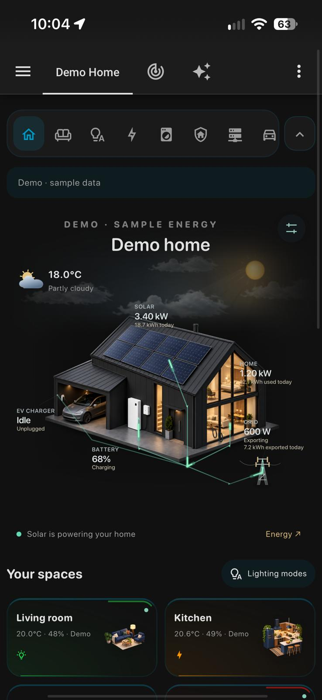
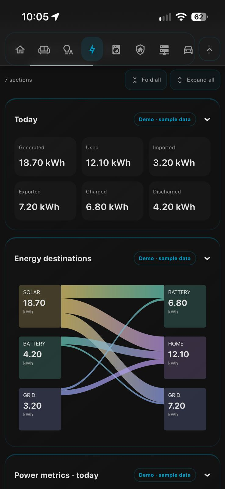

# Mobile Dashboard Starter

[](https://github.com/narayanvs/mobile-dashboard-starter#install-and-create-your-dashboard)
[](https://github.com/narayanvs/mobile-dashboard-starter/releases)
[](https://github.com/narayanvs/mobile-dashboard-starter#before-you-install)
[](https://github.com/narayanvs/mobile-dashboard-starter/actions/workflows/check.yml)
[](LICENSE)

**Beta prerelease · v0.1.0-beta.1**

An animated Home Assistant dashboard available in HA’s Community dashboards picker. No YAML, manual
file copying, extra containers or Python integration required for normal setup.
Your existing automations and dashboards are not replaced.

## Original or starter?

- **[Mobile Dashboard Starter](https://github.com/narayanvs/mobile-dashboard-starter):** this repository — generic HACS beta, native dashboard setup and demo data.
- **[Original dashboard — sanitised reference](https://github.com/narayanvs/homeassistant-dashboard):** the full dashboard from my actual home, with personal details replaced. Use it for design inspiration and advanced examples; its backend entities and automations are not installed by the starter.

## Preview

Dark previews show the starter with sample data; light previews show the original
reference dashboard. Layouts and controls vary with your configuration.
Tap an image for full size.

| Home · dark | Home · light |
| --- | --- |
| [](docs/screenshots/01-home-overview.jpg) | [](docs/screenshots/light/01-home-light.jpg) |

| Energy · dark | Energy · light |
| --- | --- |
| [](docs/screenshots/06-energy-destinations.jpg) | [](docs/screenshots/light/03-energy-statistics-light.jpg) |

[Browse the full screenshot gallery →](docs/gallery.md)

## Before you install

- **Home Assistant with HACS installed**, and an **administrator account** for
  setup. HACS supports Home Assistant OS, Container and other installation types;
  this starter does not require Supervisor or an add-on.
- An up-to-date browser or Home Assistant Companion app. Reload the frontend
  after installing so the new card is available.

**No other custom cards are required.** You do not need button-card, Mushroom,
card-mod, ApexCharts, a separate calendar card or the original dashboard package.
The starter bundles its own cards, animations and artwork. No custom theme, MQTT,
AI/MCP, extra container or backend integration is required to try **Demo only**.

For real data, connect your own integrations and map the available entities.
Weather, calendars, solar, batteries, EVs and lab monitoring are all optional;
you do not need the same equipment as the original dashboard. Historical charts
need HA Recorder/history or statistics for the mapped sensors. Calendar editing
requires a calendar integration that supports the requested operation. The
starter displays and controls existing entities; it does not install the original
home's lighting, appliance-tracking or other automations.

Requires **Home Assistant 2026.5 or newer**, which supports the Community
dashboards picker. Use a current HA release for beta testing.

## Install and create your dashboard

1. In **HACS → ⋮ → Custom repositories**, add
   `https://github.com/narayanvs/mobile-dashboard-starter` as **Dashboard**.
2. Download the latest **beta** of Mobile Dashboard Starter and fully reload
   the HA browser/app. No HA restart is needed.
3. Go to **Settings → Dashboards → Add dashboard**. Under **Community dashboards**,
   choose **Mobile Dashboard Starter**.
4. Give it **your own name**, for example **Our Home**. “Mobile Home” is only a
   suggestion; you can change the title, icon and URL before creating it. Use a
   unique URL such as `our-home`, enable **Add to sidebar**, and select **Create**.
5. Leave **Dashboard mode → Demo only** to explore the complete sample home.
   To connect devices, choose **Customise my home**, then **Discover my home**
   under Starting option and select **Apply starting option**. Review the results.
6. Save/create the dashboard and open it from the sidebar.

No temporary dashboard, Add card step, YAML or backend integration is needed.
HACS downloading the package alone does not create a dashboard; step 3 is required.
Your existing dashboards are not replaced. The name **Mobile Dashboard Starter**
identifies the package in HACS and the picker; your sidebar uses the title you
chose. To rename it later, use **Settings → Dashboards → its ⋮ menu → Edit**.
The large heading inside the dashboard is separate: change **General → title**
in the dashboard’s visual settings.

**Not listed under Community dashboards?** Fully reload HA after HACS finishes
and reopen Add dashboard. Check HA is 2026.5+ and the JavaScript module resource
is registered. The card-based setup remains available for existing installations.

## Choose your starting point

**Demo only** shows the complete sample dashboard, with discovery and entity
mapping hidden. Open **Edit dashboard → Dashboard mode → Customise my home**
to reveal setup options. Switching modes preserves your saved mappings; demo
mode does not use or control them.

- **Explore a demo:** sample rooms, appliances and animations; no real controls.
- **Discover my home:** actual HA areas and unambiguous supported entities, with
  a report of matches and choices needing review. No dummy rooms are added.
- **Start empty:** no rooms, appliances or sample readings. Add them through the
  Rooms, Appliances and Lab tabs and enable the built-in pages under General.

Applying a starting option replaces the current mappings after confirmation;
HA's Save is still required. To find more devices without resetting your edits,
use **Discover now** instead: existing mappings are preserved. Unassigned sensors,
multiple control candidates and switches not identified as lights may require manual
selection. Area presence sensors are combined for display; explicit manual presence
choices take precedence. Unassigned environmental sensors can match a unique room
name, while ambiguous matches remain blank. Energy, security, car and lab mappings remain manual.

Data mode is separate: **Demo only**, **Real data with demo placeholders**, or
**Real data only**. Discovery starts with real data only. Custom pages and installed third-party cards can be added under **Pages**.

## Connect and customise

Open your new dashboard → **Edit dashboard** (pencil or **⋮**). The strategy
settings show **Dashboard mode**. Choose **Customise my home** to reveal the
room/entity editor, then use **Discover now**, review the mappings and save.
Leave it in **Demo only** until you want real controls.

Existing card-based dashboards still use **Edit dashboard → edit the starter card**.
If you choose HA’s **Take control** option, the generated layout becomes ordinary
cards; future mapping edits are then made in the starter card editor.

- **General:** title, demo/live mode, weather and automatic discovery.
- **Pages:** add, rename, hide and reorder pages; choose templates, sections and HA cards.
- **Rooms:** choose a room, its picture and entities; add or remove rooms.
- **Energy / Flows:** choose power, daily totals, forecasts and measured flows.
  The Now/Today overview, filled power chart, household demand and consumption
  ring use the original dashboard frontend with generic mappings.
- **Appliances / Lab / Security / Car:** map the readings your integrations expose.
- **Calendars:** discovery includes HA calendars; edit names and add other available calendars.

Fields show your entity IDs and friendly names. Empty fields are optional.
Use **Save** in HA when finished. These settings are stored **with your dashboard
in Home Assistant**, not inside HACS files. You can use an AI assistant through
HA MCP to help identify the right entities, but it is not required.

**Demo only** never operates real devices, including calendar events. **Auto**
uses real mappings and labelled sample data for unmapped sections. A partly
mapped section does not fill unavailable readings with fake values. Choose
**Live only** to remove sample data entirely. Discovery avoids ambiguous matches
and does not guess inverter signs, flow attribution, alarm codes or plug controls.

Appearance, fonts, house styles and weather effects are in the floating Appearance
menu; drag its heading to move it aside. Choose **Weather → Rain, Snow or
Thunderstorm** to preview those effects, or **Auto** to follow the selected weather
entity. Animation respects the device’s reduced-motion setting. Navigation can hide/show, and detail pages
have Fold all / Expand all plus individual folds. Running appliances start expanded.

See [mapping details](docs/mapping.md) for optional fields and units. Existing
`mapping_url` JSON setups from beta.1 still work; normal new installs need no file.

## Build your own pages

1. Open **Edit dashboard → Customise my home → Pages**.
2. Select **Add page**, enter a name such as **Garage**, and choose an MDI icon
   such as `mdi:garage`. Move it left/right or hide it from navigation.
3. Choose **Blank page**, **Room controls**, or an existing feature template.
   For Room controls, first add/map the room under Rooms, then select it here.
4. Use **Add section → Add card**. Tile, entities, history graph, Markdown and
   button cards have simple fields. Sections support one or two columns on wide
   screens and stack on phones.
5. For any other built-in or installed custom HA card, paste its configuration
   as **JSON** under Advanced card configuration. It needs a `type`, for example
   `{"type":"tile","entity":"light.garage"}`. Third-party cards must be installed
   separately; the starter does not download them. These cards use your actual
   HA entities and actions, so review their configuration before saving.
6. Save in HA. Your pages appear in the starter’s navigation ribbon. You can also
   rename/reorder/hide built-in pages; their mappings stay in the existing tabs.

Pages, sections, cards and ordering are stored with the HA dashboard and survive
HACS updates. Custom pages are hidden in **Demo only**, which always shows the
complete sample home; switching back restores them. General/Rooms/Energy/etc.
are setup categories, separate from the pages you choose to display.

## Make it your own with AI (recommended for deeper changes)

For changes beyond the visual settings, connect an AI assistant to your Home
Assistant through **Home Assistant MCP**. Ask it to inspect your actual entities
and adapt one page at a time. Screenshots from either repository are useful design
references; avoid copying a complete household-specific configuration unchanged.

For example:

> Inspect my HA entities and this starter dashboard. Help me map the right sensors
> and customise the layout to suit my home. Keep existing automations unchanged,
> verify entities before using them, and back up the dashboard before editing it.
> Keep personal settings in HA rather than editing HACS-managed files.

AI and MCP are optional: native dashboard setup and the visual editor work without them.
Review proposed changes, and never paste passwords, tokens or alarm codes into
public issues or shared configuration.

## Updates and ownership

**You decide whether to update. There is no automatic updater in this package.**

- HACS updates replace the shared frontend and artwork. They do **not** replace
  your dashboard, rooms or entity mappings saved in HA.
- Saved configuration uses a versioned schema; future changes should preserve
  existing configuration or provide a migration. Beta releases can still have bugs
  or visual changes: back up HA and review release notes before updating.
- If you want to stay on one version, leave update installation alone. You can
  disable this package’s HACS update entity in HA to suppress its HA update alerts;
  HACS may still list newer versions. This does not disconnect or uninstall it.
- **Direct edits to downloaded JavaScript or artwork can be overwritten by HACS.**
  For those advanced customisations, use a [frozen local copy](docs/frozen-copy.md)
  and do not load both versions. Ordinary visual settings need no frozen copy.

Removing the repository or its downloaded files can break a dashboard that still
uses them. Creating a dashboard does not remove HACS tracking or change update settings.
Freezing a version also does not guarantee compatibility with future HA releases.

## Uninstall

HACS removes the downloaded frontend, but **does not delete dashboards you
created**. Remove them first to avoid “Custom element doesn't exist” errors:

1. Back up any dashboard configuration you want to keep. If this is your default
   dashboard, select another default first.
2. In **Settings → Dashboards**, find it by **the name you chose** (for example
   **Our Home**) and delete it. Repeat for any other dashboards using this package.
   Deleting a dashboard also removes its saved mappings. If you used the older
   setup-card flow, remove its temporary **Starter setup** dashboard or cards too.
3. In **HACS → Mobile Dashboard Starter → ⋮**, use **Remove** and follow its
   prompts. Check **Settings → Dashboards → ⋮ → Resources** and, if it remains,
   remove only the resource pointing to
   `/hacsfiles/mobile-dashboard-starter/mobile-dashboard-starter.js` (including
   any version query). Do not remove resources belonging to other packages.
4. Fully reload the browser/app to unload the frontend. A HA restart is normally
   unnecessary. A frozen local copy, if you made one, must be removed separately.

The starter creates no helpers, entities, automations, integrations or database
of its own. Existing devices and automations remain. Changes you made using real
device controls or real calendar events are not undone by uninstalling.

Small appearance, navigation and calendar-view preferences can remain in each
browser's local storage. They are inactive after removal and may be reused if
you reinstall. For a complete browser-preference reset, run this optional command
in the browser developer console **while on your HA site**, then reload. It
removes settings for all starter dashboards in that browser, not HA login data:

```js
Object.keys(localStorage)
  .filter(key => key.startsWith('mds.') || key.startsWith('mds-calendar:'))
  .forEach(key => localStorage.removeItem(key));
```

## Troubleshooting

- **Card not found:** reload the HA frontend. Check that the HACS resource is
  registered as a JavaScript module. The card type is `custom:mobile-dashboard-starter`.
- **Create disabled:** use an administrator account.
- **No discoveries:** use the editor to choose entities; check HA areas and permissions.
- **No history:** mapped sensors need recorded statistics. Gaps are not estimated.
- **No energy connections:** map measured source-to-destination kWh sensors; totals
  alone cannot reveal every flow.
- **Wrong power direction:** choose whether positive battery power means charging
  or discharging in the Energy tab. Grid is import minus export.

## Development

```sh
npm ci
npm run build
npm run check
npm test
```

`src/` contains the source; `dist/` is the complete HACS payload. Python’s standard
library builds it; Node dependencies are only for tests. Releases remain **beta
prereleases**. No credentials, real calendar events or backend automations are bundled.

Pushing `main` runs validation and publishes the version in `package.json` as a
**beta prerelease** if it does not already exist. No manual tag push is needed.
Existing releases and tags are never replaced. For another release, increment the
beta version consistently in `package.json`, `package-lock.json` and `src/config.js`,
update the changelog, build and push. Failed checks prevent publication.

### Light and dark appearance

Daylight house artwork, readable weather effects, clearer room tiles and stronger
energy/chart colours adapt to the active Home Assistant theme. Page banners have
rounded tops and a faded bottom. Dark artwork and reduced-motion support are retained.

See the [light-mode screenshots](docs/gallery.md#light-mode--reference-dashboard).
