# Screenshot gallery

[Back to the README](../README.md) · [Light mode](#light-mode--reference-dashboard) · [Dark mode](#dark-mode)

Dark screenshots show an earlier development build with labelled demo data.
Some Energy cards and setup controls differ from this release. Calendar events are examples.

Images have been reviewed and stripped of metadata. Tap an image for full size.
Animations appear still in screenshots.

## Light mode — reference dashboard

These show the actual reference dashboard with its configured devices. The starter
uses the same visual approach; mapped data and available controls vary.

| Home | Energy overview |
| --- | --- |
|  |  |

| Energy statistics | Living room |
| --- | --- |
|  |  |

| Room climate | Home Lab |
| --- | --- |
|  | [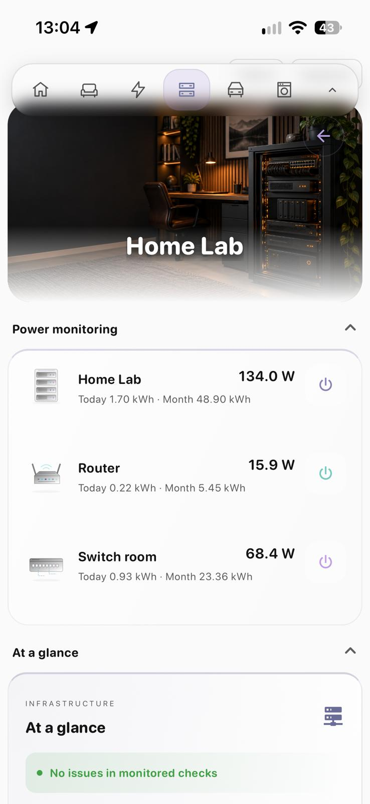](screenshots/light/06-home-lab-light.jpg) |

| Server statistics |  |
| --- | --- |
| [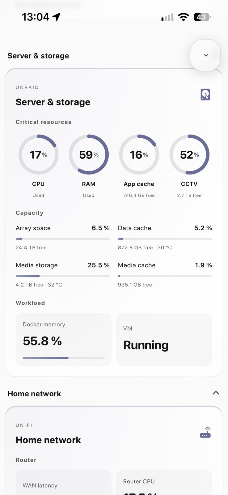](screenshots/light/07-server-statistics-light.jpg) |  |

## Dark mode

| **Home overview** | **Your Spaces** |
| --- | --- |
|  | [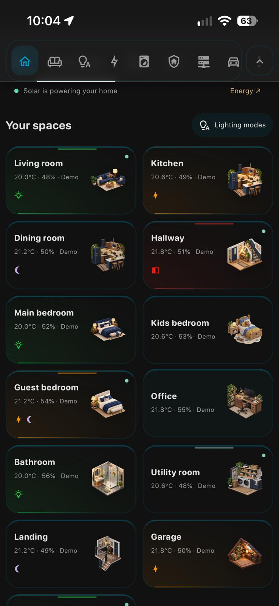](screenshots/02-your-spaces.jpg) |
| Animated house, weather and energy overview. | Two-column room tiles with light, power, door and occupancy indicators. |

| **Lighting modes** | **Living room** |
| --- | --- |
| [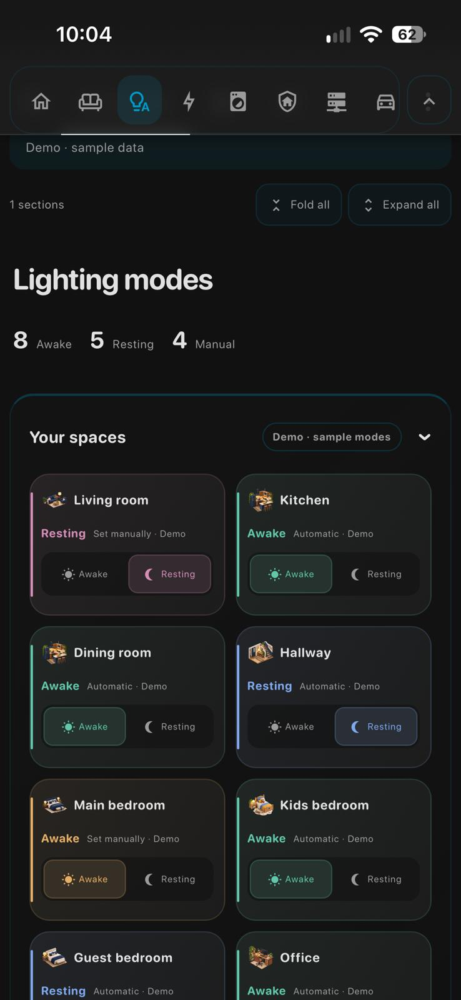](screenshots/03-lighting-modes.jpg) | [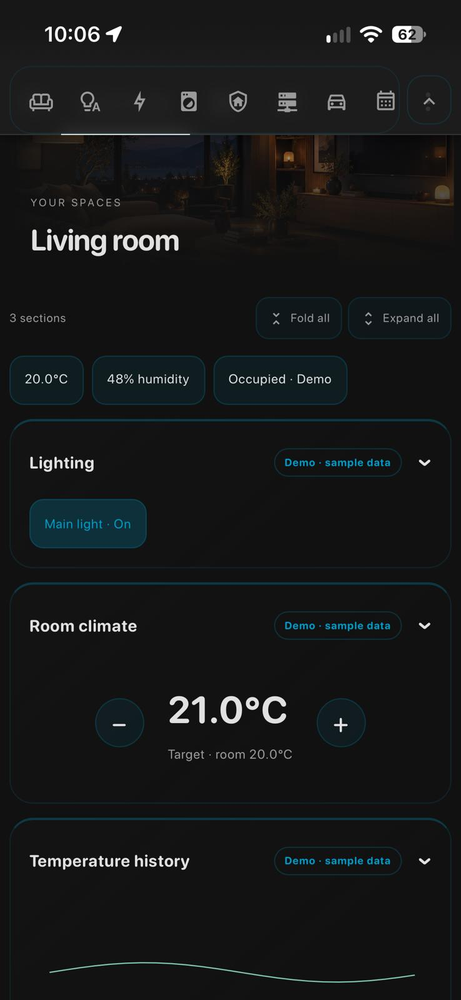](screenshots/04-living-room.jpg) |
| Awake/resting modes with automatic and manual states. | Room lighting, climate controls and temperature history. |

| **Kitchen** | **Energy destinations** |
| --- | --- |
| [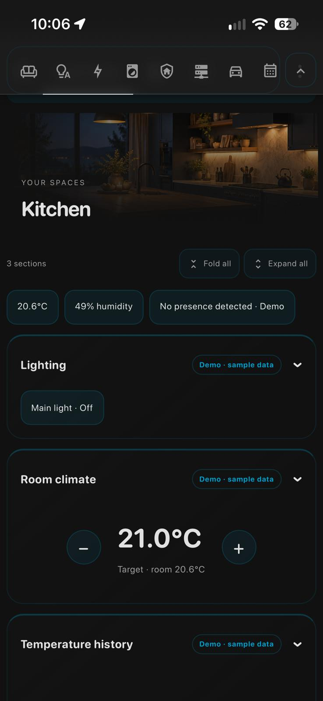](screenshots/05-kitchen.jpg) |  |
| Room artwork and compact room controls. | Daily energy totals and source-to-destination connections. |

| **Solar forecast** | **Appliance cycle** |
| --- | --- |
| [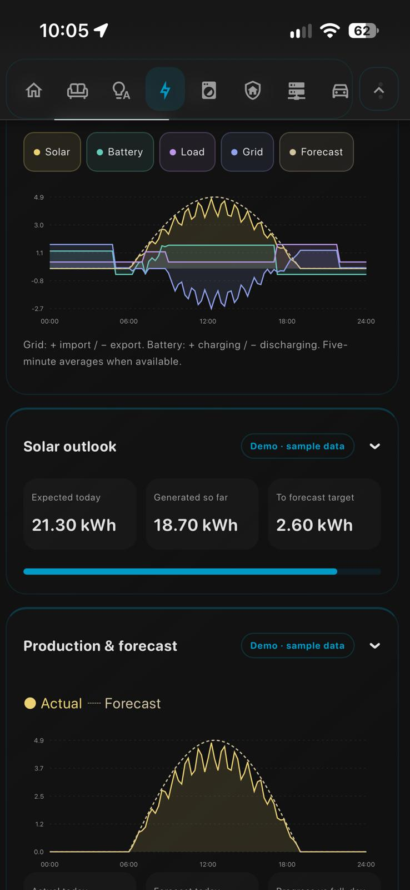](screenshots/07-solar-forecast.jpg) | [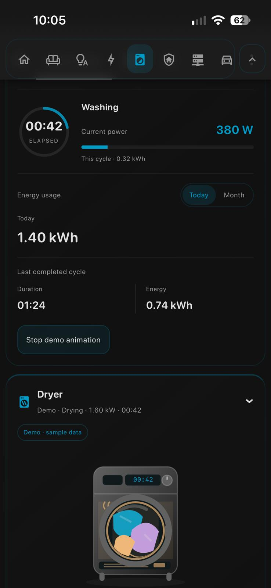](screenshots/08-appliance-cycle.jpg) |
| Power metrics, solar outlook and actual versus forecast. | Elapsed time, cycle energy, daily/monthly totals and dryer illustration. |

| **Security** | **Home Lab: power** |
| --- | --- |
| [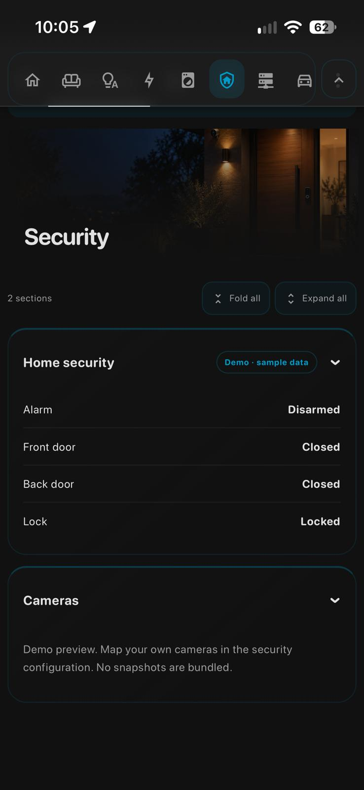](screenshots/09-security.jpg) | [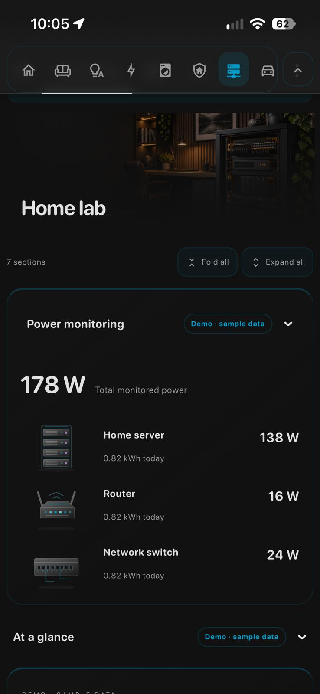](screenshots/10-lab-power.jpg) |
| Example alarm, door and lock status; no real camera snapshots. | Infrastructure power summary with device animations. |

| **Home Lab: server and storage** | **Car** |
| --- | --- |
| [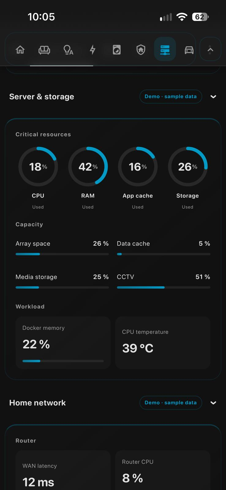](screenshots/11-lab-server-storage.jpg) | [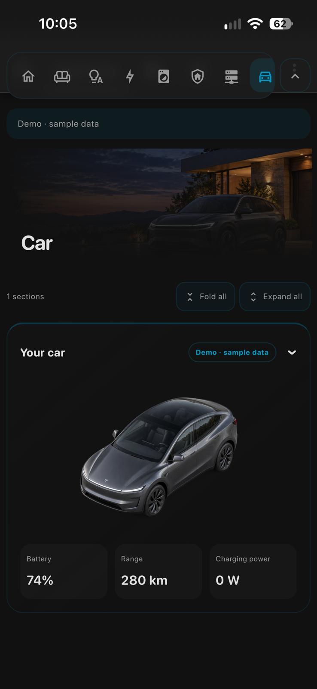](screenshots/12-car.jpg) |
| Resource rings, storage capacity and network metrics. | Car artwork, battery, range and charging power. |

| **Family calendar** | **Setup wizard** |
| --- | --- |
| [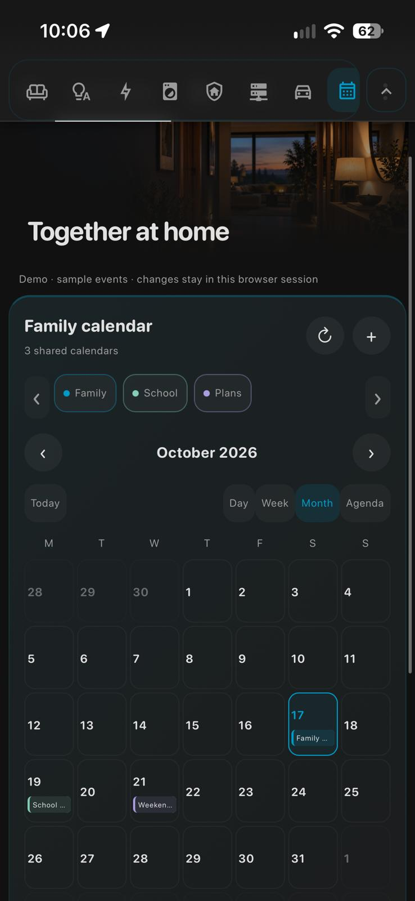](screenshots/13-family-calendar.jpg) | [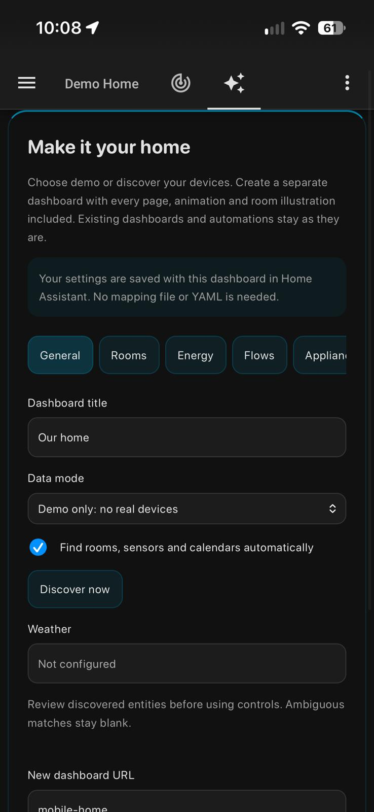](screenshots/14-setup-wizard.jpg) |
| Month view and calendar filters with sample events. | Visual setup and discovery without YAML or file copying. |
